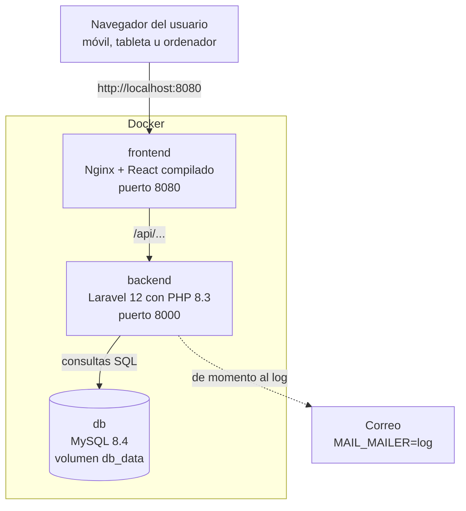

# Arquitectura y despliegue

## 1. Diagrama



## 2. Componentes

| Pieza | Qué es | Qué hace | Puerto | Archivo |
|---|---|---|---|---|
| frontend | Nginx con la web de React ya compilada | Sirve las pantallas y reenvía las rutas `/api/...` al backend | 8080 | `frontend/Dockerfile`, `frontend/nginx.conf` |
| backend | Laravel 12 con PHP 8.3 | API: login, charlas y reservas. Comprueba permisos y plazas. Al arrancar, crea las tablas y carga los datos de prueba | 8000 | `backend/Dockerfile`, `backend/docker-entrypoint.sh` |
| db | MySQL 8.4 | Guarda usuarios, charlas y reservas. Los datos se conservan en el volumen `db_data` aunque se pare el contenedor | 3306 | `docker-compose.yml` |
| Correo | Todavía no es un servicio | De momento Laravel escribe el correo en el log (`MAIL_MAILER=log`). El envío real está previsto para la semana 8 | — | `backend/.env.example` |

**Cómo se comunican:**
1. El navegador solo habla con el **frontend**, por el puerto 8080.
2. Cuando la web pide datos (`/api/talks`, `/api/login`...), Nginx se lo pasa al **backend**.
3. El backend consulta o guarda en la **db** y responde en JSON.
4. Como la web y la API salen por la misma dirección (`localhost:8080`), no hay problemas de CORS.

## 3. Entornos

| | Desarrollo | Demostración |
|---|---|---|
| Para qué | Programar día a día | Enseñar la aplicación y que otro equipo la pueda arrancar |
| Cómo se arranca | `docker compose up -d db`, después `php artisan serve` en `backend` y `npm run dev` en `frontend` | `docker compose up -d --build` |
| Dirección | `http://localhost:5173` | `http://localhost:8080` |
| Quién reenvía `/api` | El proxy de Vite (`vite.config.js`) | Nginx (`nginx.conf`) |
| Qué hay que instalar | PHP 8.3, Composer, Node y Docker (o MySQL con Homebrew) | Solo Docker Desktop |

Los pasos completos de los dos están en el `README.md`.

**Versiones:** PHP 8.3, Laravel 12, MySQL 8.4, React 19, Vite 8, Nginx 1.27.

**Variables de entorno:**
- `backend/.env.example` es la plantilla pública, sin contraseñas reales. Cada uno crea su `.env`, que no se sube al repositorio (`.gitignore`).
- La contraseña de MySQL de `docker-compose.yml` es solo de laboratorio. En la publicación de febrero irá fuera del repositorio.

## 4. Por qué esta arquitectura

**Tamaño de la aplicación.** Es una aplicación pequeña: tres perfiles, unas pocas charlas y decenas de reservas. Por eso basta con tres contenedores en un solo ordenador, sin balanceadores ni varios servidores. El backend usa `php artisan serve`, que es suficiente para la demostración; en la publicación de febrero se valorará cambiarlo por PHP-FPM detrás de Nginx, que es lo habitual en producción.

**Frontend, API y datos separados.** React solo se encarga de las pantallas, Laravel de las reglas (permisos, plazas, duplicados) y MySQL de guardar los datos. Así cada parte se puede cambiar o probar por separado, y las reglas importantes se comprueban siempre en el servidor, no en el navegador.

**Medios del centro.** Trabajamos con nuestros portátiles, y no todos tienen el mismo sistema ni las mismas versiones. Docker Desktop funciona en Mac y en Windows, y no hace falta ningún servidor del centro para la demostración.

**Repetir la instalación.** Con Docker, cualquiera puede arrancar el proyecto con un solo comando y obtiene las mismas versiones. Durante el desarrollo tuvimos errores por diferencias entre ordenadores (por ejemplo, un `Access denied` de MySQL), y los contenedores evitan ese tipo de problemas. Además, la CI de GitHub Actions comprueba en cada subida que las pruebas pasan y que el frontend compila.

## 5. Plan de publicación (futuro)

**Dónde:** pendiente de decidir con el profesor como lo publicaremos. Se usará el mismo `docker-compose.yml` que en la demostración.

**Qué hará falta:**
- **Un nombre de dominio** que apunte al servidor, y comprobar que se resuelve bien y que se puede entrar desde otro equipo.
- **HTTPS**, con un certificado gratuito de Let's Encrypt en Nginx. Es obligatorio, porque la cámara del navegador (para leer el QR) solo funciona con HTTPS.
- **Contraseñas fuera del repositorio**: un `.env` en el servidor con contraseñas nuevas, y `APP_ENV=production` y `APP_DEBUG=false`.
- **Correo real**: un servicio SMTP configurado en el `.env` (semana 8).

**Copia de seguridad de la base de datos:**

```bash
docker compose exec -T db sh -c 'exec mysqldump -uroot -p"$MYSQL_ROOT_PASSWORD" sabitech' > copia-sabitech.sql
```

**Recuperar desde la copia:**

```bash
docker compose exec -T db sh -c 'exec mysql -uroot -p"$MYSQL_ROOT_PASSWORD" sabitech' < copia-sabitech.sql
```

Si se rompe un contenedor, basta con `docker compose up -d --build`: los datos siguen en el volumen `db_data`.