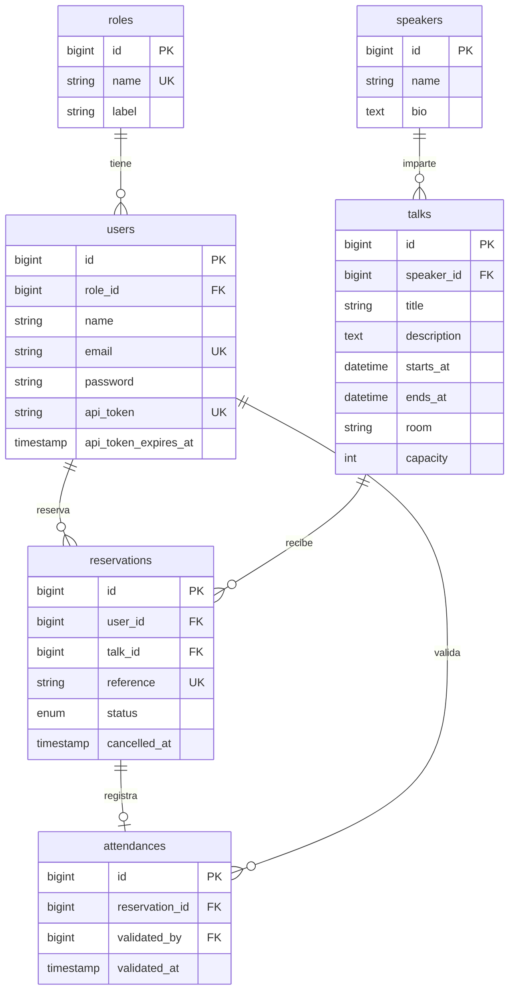

# Modelo de datos

Base de datos MySQL 8.4, gestionada con migraciones de Laravel (`backend/database/migrations`). Las pruebas automáticas usan SQLite en memoria con las mismas migraciones.

## Diagrama

## Diccionario de datos

Todas las tablas tienen además `created_at` y `updated_at`.

### roles
| Columna | Tipo | Descripción |
|---|---|---|
| id | bigint PK | |
| name | varchar(30) único | `attendee`, `organizer` o `access_staff`. El visitante sin sesión no tiene fila. |
| label | varchar(60) | Nombre para mostrar: Asistente, Organizador, Personal de Acceso. |

### users
| Columna | Tipo | Descripción |
|---|---|---|
| id | bigint PK | |
| role_id | FK roles | Perfil del usuario. No se puede borrar un rol en uso. |
| name | varchar | |
| email | varchar único | Identificador de acceso. |
| password | varchar | Hash bcrypt generado por Laravel. Nunca texto plano. |
| api_token | varchar(64) único, nulo | Hash SHA-256 del token de sesión. El token en claro solo lo conoce el cliente. |
| api_token_expires_at | timestamp nulo | Caducidad de la sesión (8 horas desde el login). |

### speakers
| Columna | Tipo | Descripción |
|---|---|---|
| id | bigint PK | |
| name | varchar | Nombre público del ponente. |
| bio | text nulo | Descripción breve. |

### talks
| Columna | Tipo | Descripción |
|---|---|---|
| id | bigint PK | |
| speaker_id | FK speakers | Ponente de la charla. |
| title | varchar | |
| description | text nulo | |
| starts_at, ends_at | datetime | Horario, en hora de Madrid (`Europe/Madrid`). |
| room | varchar | Sala. |
| capacity | int sin signo | Aforo máximo. |

### reservations
| Columna | Tipo | Descripción |
|---|---|---|
| id | bigint PK | |
| user_id | FK users | Quién reserva. Se borra en cascada con el usuario. |
| talk_id | FK talks | Qué charla. Se borra en cascada con la charla. |
| status | enum | `confirmed` o `cancelled`. Solo `confirmed` ocupa plaza. |
| reference | varchar(20) único | Referencia visible para el asistente (`RES-XXXXXXXX`). |
| cancelled_at | timestamp nulo | Cuándo se canceló. |

### attendances
| Columna | Tipo | Descripción |
|---|---|---|
| id | bigint PK | |
| reservation_id | FK reservations, único | Una reserva solo puede registrar una asistencia. |
| validated_by | FK users | Usuario que registró la validación de la entrada. |
| validated_at | timestamp | Momento de la validación. |

La tabla `personal_access_tokens` existe por la instalación inicial de Laravel, pero la aplicación no la usa: la sesión va con `users.api_token`.

## Reglas de integridad

| Regla | Mecanismo |
|---|---|
| Una persona no puede tener dos reservas para la misma charla | `UNIQUE (user_id, talk_id)`. Al volver a reservar tras cancelar se reactiva la misma fila. |
| Una reserva no puede tener dos asistencias | `UNIQUE (reservation_id)` en `attendances`. |
| Cada usuario tiene un rol existente | `users.role_id` es clave foránea a `roles`. |
| Valores de estado acotados | `ENUM ('confirmed', 'cancelled')` en `reservations.status`. |
| No se supera el aforo con peticiones simultáneas | `ReservationService`: transacción que bloquea la fila de la charla (`lockForUpdate`) antes de contar las reservas confirmadas. |
| No se reserva una charla empezada | `ReservationService` comprueba `starts_at` antes de crear la reserva. |
| Solo reservan los asistentes | `ReservationService` comprueba el perfil y devuelve `403 forbidden_role`. |

## Datos de prueba

En una instalación nueva, `php artisan migrate --seed` crea las tablas y carga los tres roles. En los entornos `local` y `testing` también añade los siguientes datos de prueba.

| Dato | Detalle |
|---|---|
| Cuentas | `ana`, `alex` y `carla` (asistentes), `organizacion` (organizador) y `acceso` (personal de acceso), todas `@sabitech.test` con contraseña `password` |
| Ponentes | Laura Martín, Paco Ibañez, Santiago García |
| Charlas (dentro de 7 días) | Introducción a la IA generativa, 10:00, 100 plazas libres · Ciberseguridad en aplicaciones web, 12:00, 1 plaza libre · Desarrollo de aplicaciones móviles, 14:00, completa |
| Reservas | Ana en Ciberseguridad y en Móviles; Alex en Móviles |

Las fechas son relativas al día en que se ejecuta el seeder, para que las charlas estén siempre en el futuro durante la demo.
